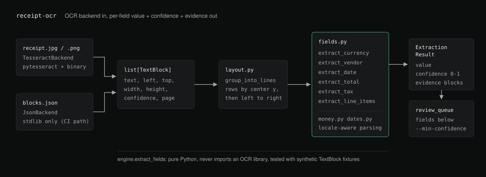

# receipt-ocr

Extract `total`, `date`, `vendor`, `tax`, `currency` and `line_items` from
receipt and invoice OCR output, with a confidence score and evidence for every
field, so a person only reviews the fields the tool is unsure about.



**Status:** version 0.1.0, not published to PyPI. The extraction engine is
covered by synthetic test fixtures and by a real Tesseract integration test on
rendered receipts. It has not been tested on photographed or scanned receipts.

## What it does

Generic OCR gives you a wall of text with per-word bounding boxes. It does not
tell you which number is the total, whether `03/04/2024` means March 4th or
April 3rd, or which line at the top is the vendor. `receipt-ocr` takes OCR
output (from Tesseract, or from a pre-extracted JSON file) and applies layout
and pattern heuristics to pull out the fields bookkeeping needs. Each field
comes back with a 0 to 1 confidence score and a pointer to the OCR blocks it
was read from.

Financial data is a bad place to trust OCR blindly: noisy text, currency
ambiguity and locale-dependent date and number formats are common. Instead of
treating every field as equally reliable, the CLI produces a **review queue**
of the fields that fall below a confidence threshold.

## Fields

- **Total**: found by keyword proximity (`total`, `amount due`, `balance due`,
  ...) and position, not by picking the largest number on the page (which is
  often an expensive line item).
- **Date**: ISO (`2024-03-14`), numeric (`14/03/2024`, `03/14/2024`) and month
  name (`14 Mar 2024`, `March 14, 2024`). When a numeric date is ambiguous
  (both parts 12 or less) it is resolved with a locale hint from the detected
  currency (USD means MM/DD, anything else DD/MM) and the confidence is lowered.
- **Vendor**: a top-of-receipt heuristic using block height and position. It
  skips addresses, phone numbers and headers such as "RECEIPT" or "INVOICE".
- **Tax / VAT**: keywords `tax`, `vat`, `gst`, `hst`, `pst` and similar, kept
  separate from the total and not confused with labels like "Tax Invoice" or
  "VAT No.".
- **Currency**: symbols (`$`, `€`, `£`, `¥`, `₹`, ...) and ISO codes (`USD`,
  `EUR`, ...) anywhere on the receipt, decided by majority vote.
- **Line items**: rows ending in an amount, excluding total, tax, subtotal and
  footer lines. Quantity and unit price are filled in for rows like
  `2 x Free-range Eggs (12)  $5.00  $10.00`.
- **Money parsing**: `1,234.56`, `1.234,56` and `1 234,56` all parse without
  assuming a US locale. Ambiguous amounts such as `1,234` are flagged and
  down-weighted.

A field that cannot be found is left out of `fields` rather than returned
empty. `line_items` is always present.

## Install

Python 3.10 or newer. The core has no runtime dependencies. The name
`receipt-ocr` on PyPI belongs to an unrelated project, so install from a clone:

```bash
git clone https://github.com/hellpuffyt/receipt-ocr && cd receipt-ocr
python -m venv .venv
.venv/bin/python -m pip install -e ".[dev]"                # macOS/Linux
./.venv/Scripts/python.exe -m pip install -e ".[dev]"     # Windows
```

To read real images with `TesseractBackend`, also install the `ocr` extra
(`pytesseract` and `Pillow`) and the Tesseract binary:

```bash
.venv/bin/python -m pip install -e ".[ocr]"
# then the tesseract binary for your OS:
#   macOS:   brew install tesseract
#   Ubuntu:  apt-get install tesseract-ocr
#   Windows: https://github.com/UB-Mannheim/tesseract/wiki
```

## Usage

Activate the virtualenv (or call `.venv/bin/receipt-ocr`), then:

```bash
# JSON backend, no native dependencies
receipt-ocr samples/sample_receipt.json --min-confidence 0.6

# Tesseract backend against an image (needs the ocr extra and the tesseract binary)
receipt-ocr path/to/receipt.jpg --backend tesseract
```

| Option | Default | Meaning |
|---|---|---|
| `input` | | OCR JSON file, or an image with `--backend tesseract` |
| `--backend {json,tesseract}` | `json` | Which OCR backend reads the input |
| `--min-confidence FLOAT` | `0.6` | Fields below this go into `review_queue` |
| `--indent INT` | `2` | JSON indentation of the output |
| `-o, --output PATH` | stdout | Write the JSON to a file |

Exit codes: `0` on success, `2` when the input file is missing, the JSON is
malformed, or the Tesseract backend's dependencies are not installed. The
error message on stderr says which.

### Input format

`JsonBackend` reads a JSON array of OCR blocks. Coordinates are pixels from
the top left, and `confidence` is 0 to 100, as Tesseract reports it:

```json
{"text": "TOTAL", "left": 30, "top": 260, "width": 70, "height": 16, "confidence": 97.0}
```

### Output

`receipt-ocr samples/sample_receipt.json` prints (evidence and line items
abridged):

```json
{
  "source": "samples/sample_receipt.json",
  "fields": {
    "currency": { "value": "USD", "confidence": 0.9522, "evidence": { "...": "..." } },
    "vendor": {
      "value": "GREENLEAF MARKET",
      "confidence": 0.9775,
      "evidence": {
        "text": "GREENLEAF MARKET",
        "blocks": [0, 1],
        "reason": "top-of-receipt heuristic (font size + position)"
      }
    },
    "date": { "value": "2024-03-14", "confidence": 0.979, "evidence": { "...": "..." } },
    "total": { "value": "119.55", "confidence": 0.7474, "evidence": { "...": "..." } },
    "tax": { "value": "8.86", "confidence": 0.9243, "evidence": { "...": "..." } },
    "line_items": {
      "value": [
        { "description": "Organic Apples 2kg", "amount": "6.50", "quantity": null, "unit_price": null },
        { "description": "2 x Free-range Eggs (12) $5.00", "amount": "10.00", "quantity": "2", "unit_price": "5.00" },
        "..."
      ],
      "confidence": 0.8932,
      "evidence": { "...": "..." }
    }
  },
  "review_queue": [],
  "min_confidence": 0.6
}
```

The sample is synthetic and internally consistent: line items 110.69 plus tax
8.86 equals the total 119.55.

### As a library

```python
from receipt_ocr.backends import JsonBackend
from receipt_ocr.engine import extract_fields

blocks = JsonBackend().extract("samples/sample_receipt.json")
result = extract_fields(blocks, source="samples/sample_receipt.json")

print(repr(result.fields["total"].value))           # Decimal('119.55')
print(result.fields["total"].confidence)             # 0.7473846153846153
print(result.review_queue(min_confidence=0.8))       # ['total']
```

## How it is built

`receipt_ocr.backends.OcrBackend` is a `typing.Protocol` with one method,
`extract(image_path) -> list[TextBlock]`.

| Backend | Native dependencies | Use |
|---|---|---|
| `JsonBackend` | none | Pre-extracted OCR output from any engine, or test fixtures. CI and the test suite use this. |
| `TesseractBackend` | `pytesseract`, `Pillow` and the `tesseract` binary | Real images. Raises a `RuntimeError` with an install hint if the extra is missing, instead of failing at import. |

The extraction engine (`engine`, `fields`, `money`, `dates`, `layout`) never
imports an OCR library. It works only on `TextBlock` objects (text, bounding
box, confidence, page), which keeps it deterministic and testable with
synthetic fixtures.

## Tests

```bash
pytest
ruff check .
mypy
```

CI (`.github/workflows/ci.yml`) runs `pytest` on Python 3.10 to 3.13 across
Ubuntu, Windows and macOS, `ruff` and strict `mypy` in a separate job, and a
smoke job that runs the CLI on the sample and checks the total is `119.55`.
CI does not install Tesseract.

The unit tests use synthetic `TextBlock` fixtures for the hard cases: a
receipt where the largest number is not the total, ambiguous DD/MM and MM/DD
dates, a missing tax line, several currencies, and noisy low-confidence text.

`tests/test_tesseract_integration.py` draws three receipts with Pillow's
bundled font (USD with an ISO date, EUR with `1.234,50` amounts and a DD/MM
date, GBP with a month-name date), runs them through the real `tesseract`
binary with English data, and asserts every field. These tests are skipped
unless the `ocr` extra and `tesseract` are installed. Run them with:

```bash
pytest tests/test_tesseract_integration.py -rs
```

Pillow's bundled font made English Tesseract misread `£` as `k`, `X` or `&`,
so the GBP fixture uses the `GBP` code.

## Limitations

- Accuracy depends on the OCR output. Skewed photos, glare, faded thermal
  paper and handwriting degrade Tesseract results, and no downstream heuristic
  fully makes up for that. The tool does no image preprocessing (deskew,
  denoise, binarize).
- Vendor detection is a size and position heuristic, not a lookup. On unusual
  layouts it can pick a slogan or address. When the vendor is printed in the
  same font as the body it can also pick an item line with high confidence: on
  a rendered test receipt with uniform text it returned `Bagel 3.25`
  (confidence 0.98) instead of `CORNER CAFE`. Check the vendor's evidence.
- The heuristics are tuned for Western-style itemized receipts and invoices.
  Multi-column or heavily stylized layouts can produce wrong line items.
- Ambiguous numeric dates fall back to a currency-based guess, with lowered
  confidence.
- Negative amounts (`-5.00`, `$-5.00`, `-$5.00`) are ignored as totals and
  line items; discounts and refunds are not modelled. Accounting parentheses
  such as `(12.00)` are read as positive.
- Multi-page input is carried in `TextBlock.page`, but the extractors treat
  all blocks as one document.
- Not tested: real photos or scans, fonts other than Pillow's default, and
  non-English Tesseract language data.

## Security

The library and CLI make no network calls, and `JsonBackend` uses the standard
`json` module. The bundled sample is synthetic; don't commit real receipts
with personal data to a public repository. Report vulnerabilities privately as
described in [SECURITY.md](SECURITY.md).

## Contributing

See [CONTRIBUTING.md](CONTRIBUTING.md). Changes are listed in
[CHANGELOG.md](CHANGELOG.md), and
[docs/PRODUCTION_READINESS.md](docs/PRODUCTION_READINESS.md) records the last
audit and what it verified.

## License

MIT, see [LICENSE](LICENSE).
